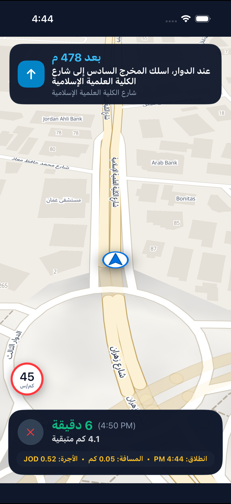
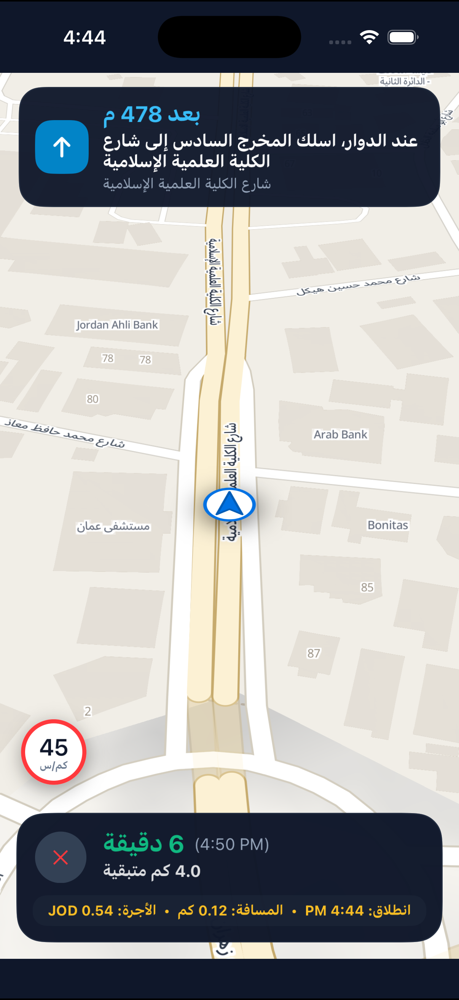

# Siro Nav for iOS (Swift)
### Native Turn-by-Turn In-App Navigation SDK for iOS (Swift • iOS 14+)

[](https://developer.apple.com/ios/)
[](https://swift.org)
[](https://opensource.org/licenses/MIT)
[](https://map.intaleqapp.com)

A high-performance, native **Swift** navigation SDK engineered for ride-hailing platforms, last-mile delivery applications, and on-demand logistics across the MENA region. Delivers complete end-to-end navigation directly within your iOS app—eliminating third-party external app launching while saving over $0.30 per ride in mapping API licensing fees.

---

## 📸 Live Visuals & iOS Simulator Verification

<div align="center">
  
  &nbsp;&nbsp;&nbsp;&nbsp;
  
</div>

- **Road-Adherent Blue Polyline**: Dual-layered navigation polyline with crisp white halo casing (`12.0px`) and navigation blue core (`7.5px`) perfectly mapped to road topology, rotaries, and intersections.
- **Intelligent Roundabout Exit Guidance**: Accurately resolves roundabout maneuvers to specific exit numbers (`Exit 1..6`) mapped directly to offline studio Arabic audio prompts and localized street names.
- **Precision Driver Marker**: Dual-layer disc marker with drop shadow and sharp directional chevron synchronized with live GPS heading and course.
- **Dynamic Tariff & Meter Engine**: Real-time tracking of distance traveled, waiting minutes under speed thresholds (<5 km/h), and cumulative fare calculations in any developer-selected currency (`JOD`, `SAR`, `AED`, `USD`).
- **Elevated Speedometer**: Floating circular speed badge with red perimeter indicator for immediate driver glanceability.

---

## 📦 Installation

### Swift Package Manager (SPM)
In Xcode, navigate to **File > Add Package Dependencies...** and enter the repository URL:
```text
https://github.com/Hamza-Ayed/siro-nav-ios.git
```

Or declare it directly in your `Package.swift`:
```swift
dependencies: [
    .package(url: "https://github.com/Hamza-Ayed/siro-nav-ios.git", from: "0.1.0")
]
```

### CocoaPods
```ruby
pod 'SiroNav', :git => 'https://github.com/Hamza-Ayed/siro-nav-ios.git'
```

---

## ⚡ Quick Start (5 Lines of Code)

### 1. Initialize Controller & Configure Fare Tariff

```swift
import SiroNav
import CoreLocation

// 1. Initialize controller with Siro Maps API Key
let config = NavConfig(
    apiKey: "YOUR_SIRO_API_KEY",
    baseUrl: "https://map-saas.intaleqapp.com/api"
)
let navController = SiroNavController(config: config)

// 2. Configure developer billing rules & custom currency
let fareConfig = NavFareConfig(
    baseFare: 0.50,            // Base starting price
    perKilometer: 0.35,        // Rate per kilometer
    perWaitingMinute: 0.05,    // Rate per waiting minute (speed < 5 km/h)
    currency: "JOD",           // Supported: JOD, SAR, AED, USD
    waitingSpeedKmh: 5.0
)

// 3. Start turn-by-turn navigation
navController.startNavigation(route: activeRoute, fare: fareConfig)
```

### 2. Embed Drop-in Navigation View (`SiroNavView`)

```swift
let navView = SiroNavView(frame: view.bounds)
navView.locale = "ar"              // Language: 'ar' or 'en'
navView.showFareMetrics = true     // Display developer fare & distance telemetry

navView.onExit = { [weak self] in
    navController.stopNavigation()
    navView.removeFromSuperview()
}
view.addSubview(navView)
```

### 3. Connect Listeners & Stream GPS Locations

```swift
navController.listener = self

// Forward raw GPS fixes from CLLocationManager
func locationManager(_ manager: CLLocationManager, didUpdateLocations locations: [CLLocation]) {
    guard let location = locations.last else { return }
    navController.updateLocation(location)
}

// Receive reactive navigation events
func onInstructionChanged(_ instruction: NavInstructionEvent) {
    navView.updateInstruction(instruction)
}

func onProgressUpdated(_ progress: NavProgressEvent) {
    navView.updateProgress(
        progress,
        totals: navController.lastTripTotals,
        startTime: navController.tripStartTime
    )
}

func onTripArrived(totals: NavTripTotals) {
    print("Trip Completed! Total Fare: \(totals.fareLabel)")
    print("Total Distance: \(totals.totalDistanceKm) km")
}
```

---

## 🧪 Automated Testing

Execute unit test suite:
```bash
swift test
```

---

## 📄 License
MIT License. © 2026 Siro Maps & Hamza Ayed.
